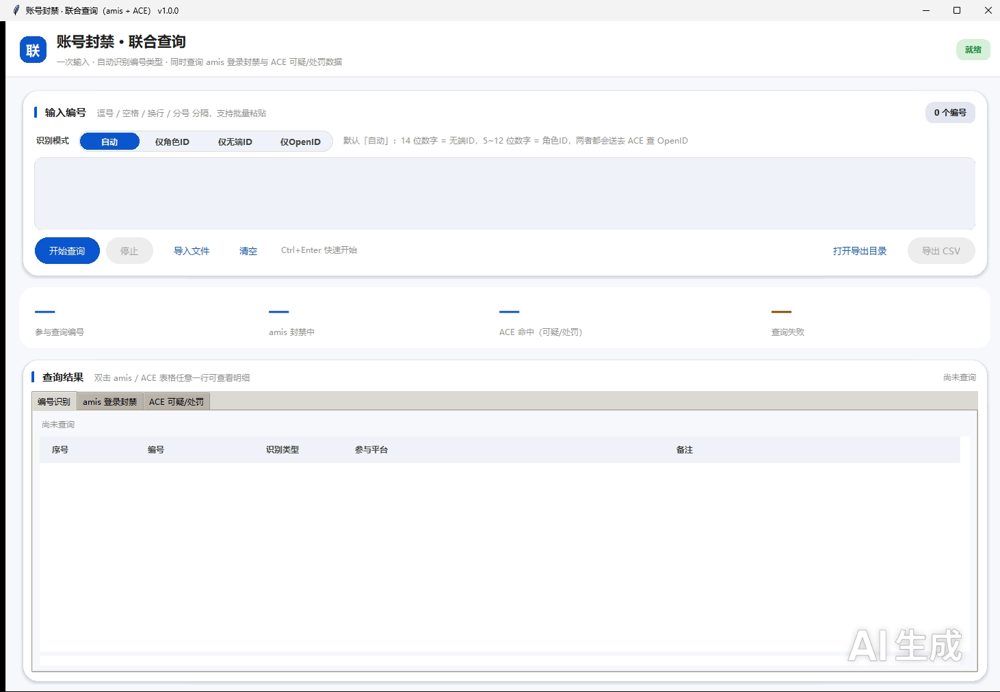

# AccountCheck · 账号封禁联合查询（amis + ACE）

[](https://github.com/Serein1202/AccountCheck/actions/workflows/build-release.yml)
[](https://github.com/Serein1202/AccountCheck/releases/latest)

一个纯标准库（tkinter）的 Windows 桌面小工具：把**两个后台的账号数据**放进同一个输入框里批量查、并排看、一次性导出。

- **amis 侧**：查「登录封禁」状态（角色 ID / 无端 ID 都能识别）
- **ACE 侧**：查「可疑用户核查」与「数据查询」记录（只认角色 ID，无端 ID 会自动换算）



> 截图是「自动识别编号」页签的初始界面；左侧输入框粘贴一批编号后点「开始查询」即可。

## 特性

| | |
|---|---|
| **批量并发** | 一次粘贴 N 个编号，两个平台**同时**开查、互不等待；平台内部按编号并发，ACE 的「核查 + 数据」两条链路以及处罚记录翻页也并行，另有在途请求总闸防瞬时压力过高 |
| **编号自动识别** | 14 位纯数字 → 无端ID；2~12 位数字 → 角色ID；其余提示并跳过（也可强制切换识别模式） |
| **无端ID 自动换算** | ACE 的 OpenID 只认角色ID，因此无端ID 会先经 amis 角色信息接口换算成角色ID 再去查 ACE；换算不到就跳过 ACE，**绝不拿无端ID 硬查**导致对不上数据 |
| **实时进度 / 随时停止** | 进度按「编号」计数（一个编号在两边都查完才算完成），停止后不再发新请求 |
| **双击看明细** | 三个结果区块（编号识别 / amis 登录封禁 / ACE 数据）任意一行双击弹出明细，带截图的记录显示缩略图，单击看大图 |
| **独立登录态** | amis 走 Token（本地缓存 → 浏览器 → 登录框），ACE 走 Cookie（凭据文件 → 自动登录）；哪边失效只弹哪边的登录框，换新后自动续跑本批 |
| **统一导出** | 单个 CSV，含「编号识别 / amis 汇总 / amis 明细 / ACE 汇总 / ACE 明细」五段，写入程序目录的 `查询结果/` 子目录，文件名带时间戳 |
| **授权保护** | 启动时经 [license-guard](https://github.com/Serein1202/license-guard) 校验授权码；服务端临时故障（限流、网关错误）会走离线容忍，不会把正常用户挡在门外 |
| **自动更新** | 启动后自动比对 Release 版本，有新版本即**断点续传**下载（内置多个 GitHub 加速镜像，可按需覆盖）、校验 SHA256，再自动替换重启；也可点右上角「检查更新」手动触发 |
| **错误上报** | 内置 Sentry 上报（已脱敏：长数字→`<id>`、密钥→`<redacted>`、用户名路径→`<user>`），可用环境变量关闭 |

## 下载即用（免装 Python）

到 [Releases](https://github.com/Serein1202/AccountCheck/releases/latest) 下载 `AccountCheck.exe`，双击即可运行 —— 单文件、免安装，无需装 Python 或任何依赖（Windows 10/11 x64）。

- 授权码已在构建时打进 exe，开箱即用
- 文件校验和见同目录的 `AccountCheck.exe.sha256`
- 每次推送到 `main` 都会自动重新打包并覆盖更新该 Release（下载链接固定不变）
- **以后不用再来手动下载**：程序会自检更新（见下方「自动更新」一节）

> 首次运行 Windows 可能提示"已保护你的电脑"（无代码签名证书的正常现象），点"更多信息 → 仍要运行"即可。

## 快速开始（从源码运行）

需要 **Python 3.8+**（Windows 官方版自带 tkinter，无需安装第三方包）。

```bash
git clone https://github.com/Serein1202/AccountCheck.git
cd AccountCheck

# 把授权码写进程序目录的 license.key（见下方「授权」一节）
echo YOUR-LICENSE-KEY > license.key

# 启动 GUI（推荐用 pythonw，不弹黑框）
pythonw joint_query.py
```

命令行自检（不联网，用于确认环境完整）：

```bash
python joint_query.py --selfcheck     # 全部通过 → 说明依赖、模块接口、导出逻辑正常
python joint_query.py --version
```

## 目录结构

```
AccountCheck/
├─ .github/workflows/
│  └─ build-release.yml    # CI：push 到 main → 打包单文件 exe → 自检 → 发布 Releases
├─ joint_query.py          # 唯一的代码入口：GUI + 联合查询编排 + 错误上报（Sentry）
├─ src/                    # 库模块
│  ├─ amis_query.py        # amis 侧查询 + 共享的自绘 UI 组件（进度条 / 胶囊页签）
│  ├─ ace_query.py         # ACE 侧查询引擎（登录 / 核查 / 数据查询 / 截图下载）
│  ├─ license_boot.py      # 授权接入层（启动校验 + 运行期看门狗 + 服务地址/公钥）
│  ├─ update_check.py      # 自动更新（版本比对 / 加速镜像竞速 / 断点续传 / 替换安装）
│  └─ vendor/
│     └─ license_guard.py  # license-guard 官方 SDK（零依赖）
└─ docs/
   └─ screenshot.png       # 界面截图
```

程序只有一个入口 `joint_query.py`：amis / ACE / 授权 / 上报都已收在它和 `src/` 里，直接 `pythonw joint_query.py` 即可。

## 使用说明

**编号格式**：支持逗号 / 空格 / 换行 / 分号混合分隔，也可以点「导入文件」从 txt / csv 读取。

**识别模式**：`自动`（按位数判断）/ `仅角色ID` / `仅无端ID`。自动模式下的判定规则是 14 位 → 无端ID、2~12 位 → 角色ID。

**登录态**：首次使用会分别弹 amis 与 ACE 的登录窗口；amis 的 Token 缓存在程序目录 `.amis_token.json`，ACE 的凭据缓存在 `ace_session_credentials.json`。这两个文件**属于敏感凭据，已加入 `.gitignore`，请勿提交或分发**。

**导出**：点「导出 CSV」，结果落在程序目录 `查询结果/` 下。

## 授权

本项目接入 [license-guard](https://github.com/Serein1202/license-guard) 做启动校验：

- 授权码查找顺序：
  1. 环境变量 `LICENSE_KEY` / `748291635_LICENSE_KEY` / `APP_LICENSE_KEY`
  2. 程序目录 `license.key`（打包成 exe 时 = exe 所在目录）
  3. 程序目录 `.license`
  4. **打包内置**的 `license.key`（CI 从 Secret 注入、随 exe 一起打包，单文件模式解包在 `sys._MEIPASS`）
  5. `%LOCALAPPDATA%\748291635\license.key`
- 仓库**不包含** `license.key`：从源码运行时请自行按上面的顺序放置；从 Releases 下载的 exe 已内置授权码，无需配置
- 运行期会按服务端下发的 `heartbeat_sec` 周期性复查；被判失效时按服务端策略退出
- 服务端返回**临时性错误**（边缘限流页、网关错误页）时会降级为「联不上」走离线容忍期，不会因为一次限流就打不开程序；真正的失效码（`LICENSE_EXPIRED` / `LICENSE_REVOKED` / `KEY_NOT_FOUND` …）仍严格按服务端策略处理

> ⚠️ 因为发布版 exe 内置了授权码，任何拿到 exe 的人都能使用（这正是"免配置下载即用"的代价）；如需严格按用户发放，应改为「发布不带内置码的 exe + 每个用户单独发码」。

## 自动更新

程序内置更新器（`src/update_check.py`，纯标准库），逻辑如下：

| 环节 | 做法 |
|---|---|
| **检查** | 启动 6 秒后静默检查一次；也可点右上角「检查更新」手动检查。优先读 Release 里的 `latest.json`（几 KB，不受 GitHub API 60 次/小时限流影响），取不到再退回 GitHub REST API |
| **加速** | 所有请求按「加速前缀 + 原始地址」拼多个候选源**并发竞速**，谁先答上就用谁（默认含 `gh-proxy.org`、`ghfast.top`、`ghproxy.net`、`gh.llkk.cc`、`hub.gitmirror.com`、`ghproxy.cc`）；下载前还会先探测各源首字节速度，挑最快的开下 |
| **断点续传** | 数据写入 `%LOCALAPPDATA%\AccountCheck\updates\*.part`，用 HTTP `Range` 从已下字节继续；换镜像时核对总长度，对不上说明远端文件已换则重下；服务器不支持 Range（回 200）时自动整包重下。中断/关程序都不丢进度，下次接着下 |
| **校验** | 下完比对文件大小与 SHA256（来自 `latest.json`，缺失则读 `AccountCheck.exe.sha256` 资产），只有校验通过才改名成正式安装包 |
| **安装** | Windows 不允许覆盖正在运行的 exe，因此交给一个脱离本进程的外部程序完成：主方案是 `powershell -EncodedCommand`（脚本以 Base64/UTF-16LE 传入，中文 / 空格路径无需转义），失败退回临时 `.bat`。替换采用「同目录临时文件 + 原子替换」并自动重试，因此目标文件只会是完整的旧版或完整的新版，不会出现半截；成功后自动启动新版 |

图形界面里：右上角状态变黄即表示「发现新版本」，点它就能下载；下载进度显示在底部进度条；装完会询问是否立即重启完成更新。

命令行用法（适合脚本/排查）：

```bash
AccountCheck.exe --check-update    # 只检查；退出码 0=已最新，10=有新版本，1=失败
AccountCheck.exe --update          # 检查 → 断点续传下载 → 校验 → 替换安装
```

自定义加速源（默认列表失效时很有用）：建一个 `%LOCALAPPDATA%\AccountCheck\mirrors.json`，内容形如
`{"prefixes": ["https://你的加速前缀/"]}`；或设环境变量 `JOINT_UPDATE_MIRRORS`（逗号分隔，写 `none` 表示只用直连）。
更新日志与下载片段都在 `%LOCALAPPDATA%\AccountCheck\`（`update.log` 可用来排查替换是否成功）。

## 自动化发布（CI/CD）

`.github/workflows/build-release.yml`：**每次推送到 `main`（或手动触发）** 会自动完成

1. 计算发布版本号：取 `joint_query.py` 里 `VERSION` 的前两段作主次版本，patch 位用 CI 构建号——**每推送一次自动 +1**（如 v1.0.3 → v1.0.4），并生成 `_build_version.py` 打进 exe（使 exe 内 `--version` 与 Release 名一致）
2. 校验 Secret 是否就绪，把仓库 Secret **`APP_LICENSE_KEY`** 写入 `license.key`
3. PyInstaller 打包成单文件 GUI exe（`--onefile --windowed`，内置授权码）
4. **在打包产物里跑一次 `--selfcheck`**，退出码非 0 则中止发布（挡住"漏打模块 / 授权码没进包 / 冻结后路径写错"这类只在 exe 上暴露的问题）
5. 生成 SHA256 校验和与 **`latest.json`**（版本清单，供客户端自动更新比对）→ 上传 Artifact（存档 90 天）→ 以 `AccountCheck v1.0.N` 为名覆盖更新 `latest` Release

### 首次使用前必须配置 Secret

`Settings → Secrets and variables → Actions → New repository secret`

| Name | Value |
|---|---|
| `APP_LICENSE_KEY` | 你的 license-guard 授权码（从后台生成，产品选 AccountCheck） |

未配置该 Secret 时，工作流会在**注入授权码**这一步直接失败并给出明确提示，不会产出不可用的 exe。

构建产生的 `build/`、`dist/`、`*.spec`、`license.key` 均已在 `.gitignore` 中，不会进入仓库。

## 环境变量

| 变量 | 作用 |
|---|---|
| `LICENSE_KEY` / `APP_LICENSE_KEY` | 直接指定授权码（优先级最高） |
| `LICENSE_GUARD_DEBUG` | 设为 `1` 打印授权校验细节 |
| `JOINT_SENTRY=0` | 关闭 Sentry 上报 |
| `JOINT_SENTRY_DSN` | 覆盖内置上报 DSN |
| `AMIS_PROJECT_DIR` / `ACE_PROJECT_DIR` | 指定额外的登录态凭据回退目录（默认留空） |
| `JOINT_UPDATE_MIRRORS` | 覆盖自动更新的加速前缀列表（逗号分隔；`none` = 只用直连） |
| `JOINT_UPDATE_DISABLE` | 设为 `1` 关闭自动更新检查（程序完全不联网查版本） |

## 免责声明

本工具仅用于**在获得授权的范围内**查询、核对本人或已获授权账号的封禁 / 处罚记录，便于申诉与数据自查。请勿用于未授权的数据抓取，或任何侵犯他人隐私、违反平台服务条款的用途。使用者需自行承担因不当使用产生的一切后果。

## License

暂未指定开源许可证；如需使用 / 分发请先联系作者。
